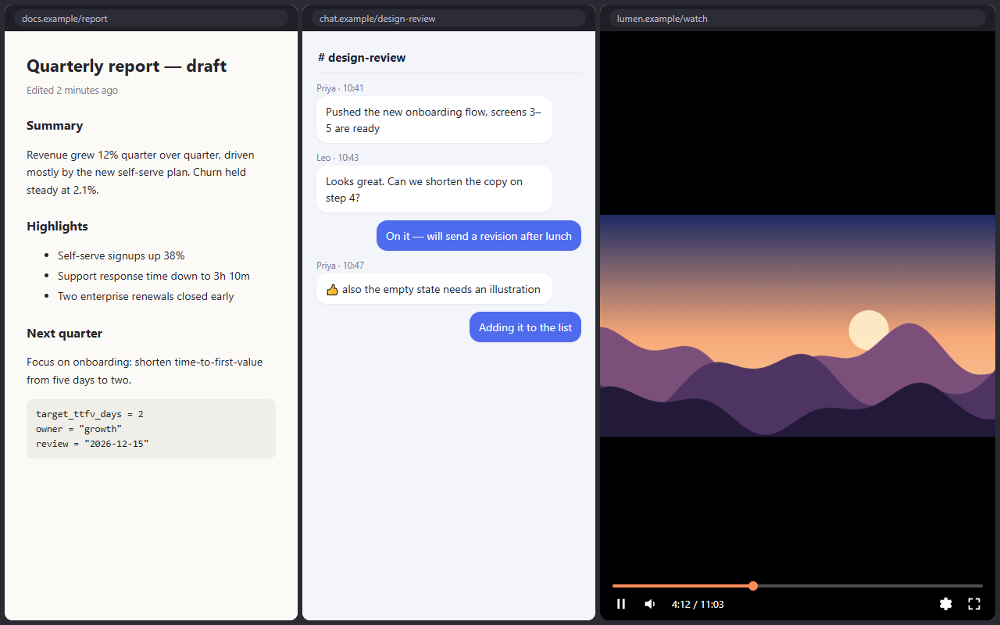
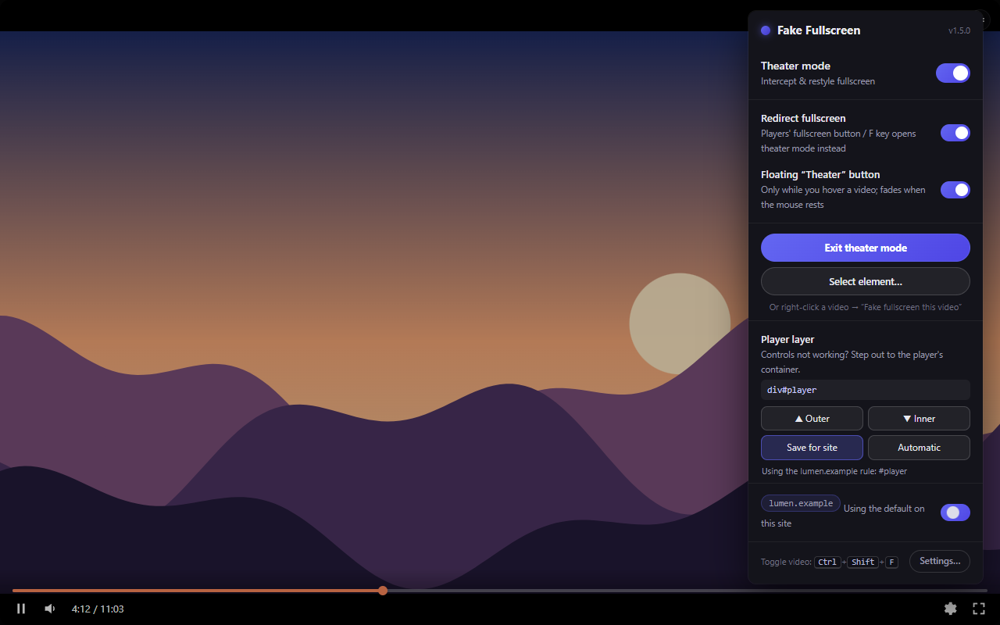

  

<h1 align="center">Fake Fullscreen – Theater Mode</h1>

  Put <strong>any video</strong> in a borderless theater view that fills <strong>just its tab</strong>. 
  Built for <strong>split-view browsing</strong>: one pane is the video, the others stay yours.

  
  
  
  

  
  
  

  

## Why

Real fullscreen takes over your whole screen. Site theater modes still leave
the masthead, comments and sidebar around the picture. Fake Fullscreen makes
the video fill **its own tab**, and nothing else. Put two or three pages side
by side and let one of them be *just the video*, while the player's own
controls (seek bar, volume, settings) keep working.

## Features

- 🎬 **Works on any HTML5 video.** YouTube, Vimeo, direct `.mp4`
  files, embedded players in iframes, and players inside Shadow DOM.
- ↪️ **Fullscreen redirect.** The player's own fullscreen button and the
  <kbd>F</kbd> key open theater mode instead of OS fullscreen. Not even a
  one-frame flash.
- 🎛️ **Player controls keep working.** The whole player is elevated, not just
  the `<video>`, so seek bars, menus and keyboard shortcuts stay usable.
- 🎯 **Pick any element.** Theater mode for anything on the page, including
  cross-origin embeds the extension can't see into.
- 🌐 **Per-site rules.** Turn it on or off per site, and save which player
  layer to use when a site needs it.
- 🪶 **Lightweight and private.** No frameworks, no tracking, no network
  requests. Only the `storage` and `contextMenus` permissions.

  

## Install

| Browser | Get it |
| --- | --- |
| Chrome, Brave, Edge, Vivaldi, Opera, Arc | [Chrome Web Store](https://chromewebstore.google.com/detail/fake-fullscreen-%E2%80%93-theater/mbnoeaojecgjfpkgmkbnekfgkohiapbi) |
| Firefox, Zen | [Firefox Add-ons](https://addons.mozilla.org/en-US/firefox/addon/fake-fullscreen-theater-mode/) |
| Manual install | `.zip` packages on [GitHub Releases](https://github.com/Amoralchik/fake-fullscreen/releases) |

Store installs update automatically. To load a development copy, see
[CONTRIBUTING.md](CONTRIBUTING.md#loading-a-development-copy).

## Usage

| Action | How |
| --- | --- |
| **Enter theater** | The player's fullscreen button or <kbd>F</kbd> · <kbd>Ctrl</kbd>+<kbd>Shift</kbd>+<kbd>F</kbd> (<kbd>⌃⇧F</kbd> on macOS) · right-click a video → **Fake fullscreen this video** · hover a video → the floating **Theater** button |
| **Exit** | <kbd>Esc</kbd> · double-click the picture · the fullscreen button again · the small exit icon |
| **Pick an element** | Toolbar icon → **Select element…** → click anything on the page (<kbd>Esc</kbd> cancels) |
| **Control panel** | Click the toolbar icon: master switch, fullscreen redirect, floating button, per-site toggle |
| **Change the shortcut** | Chromium: `chrome://extensions/shortcuts` · Firefox/Zen: `about:addons` → ⚙ → **Manage Extension Shortcuts** |
| **All settings** | Control panel → **Settings…** |

Want real fullscreen back? Switch off **Redirect fullscreen** in the control
panel. Don't want the floating button? Switch it off too; every other way in
still works.

### Settings

- Master on/off switch
- Redirect native fullscreen to theater mode (on by default)
- Per-site on/off rules, with a default of *run everywhere* or *opt-in*
- Per-site player layer, as a CSS selector or ±N layers (YouTube ships with one)
- Floating button on/off, hover-only visibility
- Hide native controls in theater
- Click outside the video to exit
- Backdrop darkness

Settings sync through your browser account (Chrome sync / Firefox Sync) when
it's available.

## Troubleshooting

**The player's controls don't respond in theater mode.**
Theater mode elevated the bare video instead of the player around it. Open
the toolbar panel, use **▲ Outer** in the **Player layer** card until the
controls work, then click **Save for site**. **Automatic** forgets the rule.

**Right-click on YouTube shows YouTube's menu.**
Right-click a second time (or <kbd>Shift</kbd>+right-click in Firefox) to get
the browser menu with *Fake fullscreen this video*.

**A video inside an embed only fills the embed.**
Cross-origin iframes can't escape their own frame. Use **Select element…** and
click the embed: the whole frame goes to theater mode.

### Known limitations

- Videos inside **closed** shadow roots are invisible to extensions.
  Most players use open roots.
- Players that draw to `<canvas>`/WebGL instead of `<video>` aren't supported.
- A site that keeps its own copy of `requestFullscreen` can bypass the
  redirect. A safety net still reroutes it, after a brief real-fullscreen flash.
- <kbd>F11</kbd> (browser window fullscreen) is left alone on purpose.
- DRM sites (Netflix and similar) work, but their UI layers sometimes fight back.

## Privacy

Fake Fullscreen collects nothing and makes no network requests. Your settings
stay in your browser's own storage. See [PRIVACY.md](PRIVACY.md).

## Contributing

Issues and pull requests are welcome. [CONTRIBUTING.md](CONTRIBUTING.md)
covers loading a dev copy, tests, packaging and releases, and
[docs/HOW-IT-WORKS.md](docs/HOW-IT-WORKS.md) explains the internals.

## License

[MIT](LICENSE) © 2026 Vitalii Piven
